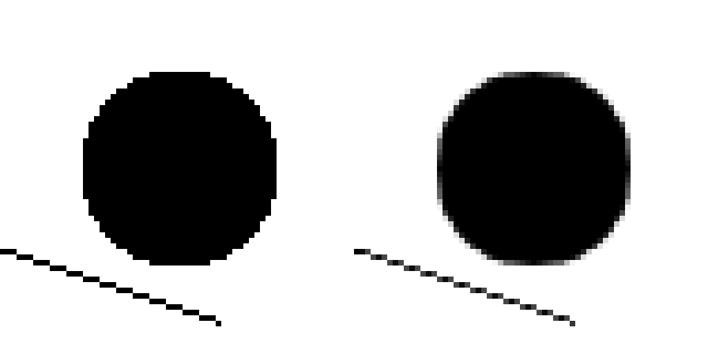
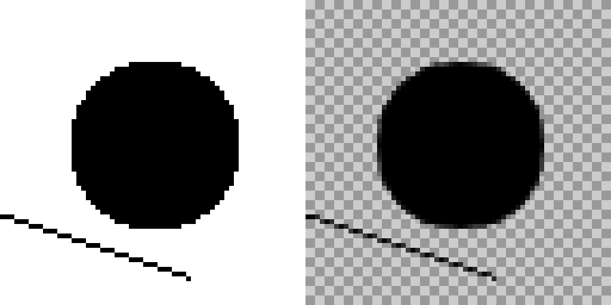

# OLM Smoother for YMM4

製作者：Sabiasagi



## 概要

YukkuriMovieMaker4 で使える映像エフェクトプラグインです。
アニメの線画向けに、二値化した線などのジャギー（階段状のギザギザ）を、ぼかさずに滑らかにします。

OLM Digital が After Effects / Nuke 向けに公開している「OLM Smoother」と同じパラメータを持つエフェクトを、YMM4 用に作りました。
アルゴリズムは OLM Smoother が参考にしている Morphological Antialiasing（MLAA）をもとにした独自実装で、処理はすべて GPU（Direct2D カスタムエフェクト）で行います。

> **非公式のプラグインです。** OLM Digital, Inc. とは関係がなく、OLM Smoother のコードやバイナリは使っていません。
> 本家と見た目が完全に一致するわけではありません。

## 使用方法

1. [Releases](../../releases) から `OLMSmootherYMM4.ymme` をダウンロードし、YMM4 にドラッグ＆ドロップしてインストールします。
2. YMM4 を再起動します。
3. アイテムに映像エフェクト「加工」→「OLM Smoother」を追加します。

### パラメータ

| 名前 | 本家での名前 | 内容 |
| --- | --- | --- |
| カラーキーを使う | Use Color Key | オンにすると、スムージングの前に「キーの色」を透明にします。抜いた背景との境目は半透明になって滑らかにつながります。 |
| キーの色 | Color Key | 透明にする色です。既定は白です。 |
| スムース範囲 | Do Smooth Range | 色の差（0〜255 階調）がこの値以下なら同じ色とみなします。背景にグラデーションがあって線が滑らかにならないときに上げてください（目安は 6 前後）。キーの色の許容範囲にも使います。 |



### 仕組み

1. **輪郭検出**：隣の画素との色の差が「スムース範囲」を超える境界を輪郭とします。
2. **形の判定**：輪郭を直線区間として端まで辿り（最大 64px）、両端の段差の向きから本来の線の傾きを推定します。
3. **混合**：推定した線と画素の境界に挟まれた面積の分だけ、隣の画素の色を混ぜます。

色を足し合わせるだけなので、線の太さや形は変わらず、段差の部分だけが中間色になります。

## アンインストール方法

1. YMM4 を起動して `ヘルプ(H)` > `その他` > `プラグインフォルダを開く` をクリックします。
2. YMM4 を終了します。
3. `OLMSmootherYMM4` という名前のフォルダを削除します。

## 注意点

- アイテムの画像の外枠そのものは輪郭として扱いません（写真などの角が欠けないように）。
- 1px の細い線は、段差のつなぎ目が少し薄くなります（MLAA の性質です）。
- 長方形の角のような鋭い角は、少し丸くなります。
- 本家は 8bit の画像を前提にしているので、「スムース範囲」も 8bit の階調で指定します。

OS：Windows 11（64bit）
ゆっくりMovieMaker4：v4.55.1.1 の Direct2D 環境で描画テスト済み（下の「検査」を参照）

免責事項：_作者は、本プラグインの使用または使用不能に起因するいかなる損害についても、一切の責任を負いません。_

## ビルド

.NET 10 SDK と Windows SDK（fxc.exe）が必要です。

```powershell
dotnet build -c Release -p:YMM4DirPath=C:\path\to\YukkuriMovieMaker_v4\
# ビルド後に YMM4 の user\plugin へコピーする場合
dotnet build -c Release -p:YMM4DirPath=C:\path\to\YukkuriMovieMaker_v4\ -p:DeployToYmm4=true
```

## 検査

`tests/RenderCheck` は、YMM4 の Direct2D 環境（`GraphicsDevices`）でプラグインを実際に動かし、CPU の参照実装（面積は数値積分）と画素ごとに比べます。手計算した値（段差のある長方形の角 = 0.45 など）も確かめます。

```powershell
cd tests\RenderCheck
dotnet build -c Release -p:YMM4DirPath=C:\path\to\YukkuriMovieMaker_v4\
.\bin\Release\net10.0-windows10.0.19041.0\RenderCheck.exe C:\path\to\YukkuriMovieMaker_v4\ .\out
```

## アップデート内容

v1.0.0
公開

## ライセンス

本プロジェクトは MIT License のもと公開しています。
[MIT License](./LICENSE)

「OLM Smoother」は OLM Digital, Inc. のツールの名前です。参考：[OLM Smoother](https://www.olm.co.jp/post/olm-smoother)
